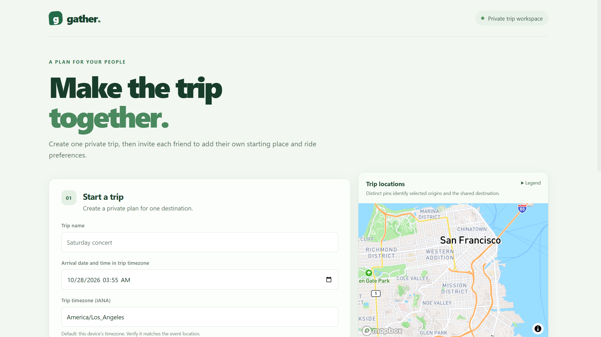
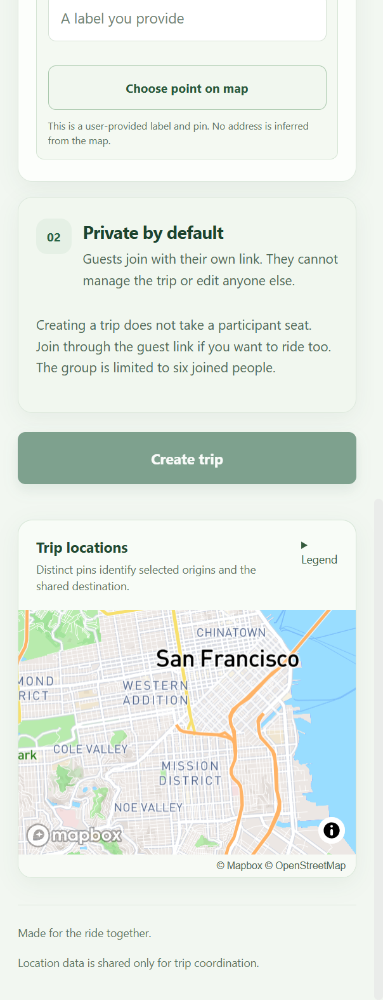

# Let's Carpool

Let's Carpool helps friends going to one event or destination coordinate a private carpool. The organizer creates a trip and shares a guest link; each guest enters their own starting place and ride preferences. The organizer compares pickup and rendezvous options and selects a plan.

The current app is a local-development MVP. It does not have accounts, hosted/shared trip storage, production deployment, road routing, or arrival-time optimization.

## Screenshots

These are unedited captures from the running app with generic sample trip data. The narrow capture is the viewport that was available during capture; it is not a 390-pixel mobile verification.

**Create trip — 2240 × 1260 browser viewport**



**Create trip — 604 × 1574 browser viewport**



## Trip flow

1. An organizer creates a trip with a name, destination, arrival time, and IANA time-zone ID. The arrival time must include an explicit UTC offset that matches the selected time zone.
2. The organizer receives two separate private links: an organizer-management link and a guest invitation link. Creating a trip does not use a participant place.
3. Each guest opens the invitation, reviews the trip summary, and enters their own starting place, whether they can drive, passenger-seat availability, whether they can travel to a rendezvous, and their maximum driver detour if they offer a vehicle. Guests may edit only their own entry. The organizer can join through the guest flow if they also plan to travel.
4. The organizer generates pickup and rendezvous alternatives and selects one. Any trip or participant edit changes the revision and makes the saved plan stale until a new plan is generated and selected.
5. Each guest sees their own assignment and the stops needed for their group, not other groups' private travel details.

The trip is limited to six joined people total, including the organizer only if they join. `passengerSeats` is separate from `canDrive` and counts seats available for riders; it excludes the driver and is limited to 0–8.

## Project layout

| Path | Purpose |
| --- | --- |
| `LetsCarpool.Server/` | ASP.NET Core API, trip coordination, and bounded carpool planner |
| `LetsCarpool.Server/Controllers/TripsController.cs` | Private-trip HTTP routes |
| `LetsCarpool.Server/Trips/` | Capability checks, trip revisions, DTOs, and local JSON store |
| `LetsCarpool.Server/Carpooling/` | Stateless pickup/rendezvous planner and distance estimates |
| `LetsCarpool.Server.Tests/` | Focused executable server checks |
| `letscarpool.client/` | React 19, TypeScript, and Vite client |
| `letscarpool.client/src/trips/` | Create, invite, organizer, and participant views |
| `letscarpool.client/src/places/` | Map and location selection components |
| `letscarpool.client/tests/` | Focused client regression tests |
| `docs/images/` | Screenshots included with this README |

Private-trip records are stored in `LetsCarpool.Server/App_Data/trips.json` by default. That directory is ignored by Git. The store is designed for one local server process; it is not shared or coordinated across multiple instances. Expired capabilities do not automatically remove trip records, and there is no automatic retention or purge policy. Removing the JSON store discards the local trips and cannot restore lost capabilities. The server project also contains older SQL/EF scaffolding, but the private-trip MVP uses the JSON store and does not require a SQL Server connection.

## Prerequisites

- .NET 10 SDK and the .NET 10 targeting pack, with NuGet restore available. `global.json` selects stable SDK `10.0.403` and rolls forward within the .NET 10 feature band.
- Node.js 22 and npm for client checks and Release publish. The repository does not pin a specific Node patch release.
- A Mapbox public browser token for rendering the map and selecting a pin. Mapbox usage is metered; a free allowance is not a spending cap. The app does not change account, billing, or quota settings.

### Local Mapbox configuration

In `letscarpool.client`, copy `.env.example` to `.env.local` if the local file does not already exist, then set `VITE_MAPBOX_ACCESS_TOKEN` there. `.env.local` is ignored by Git. This is a public browser token, not a server secret: restrict its allowed referrers to the local app origin you use (for example `http://127.0.0.1:57082`) and enable only the scopes needed to display the map. Do not commit the value or include it in screenshots or reports.

Without a token, the map and pin selection are unavailable, so the client cannot complete a trip location. With a map, a person can enter their own location label and place a pin; the app does not infer an address from the pin, and the normal UI does not ask for raw coordinates. Address and venue search is currently disabled. Temporary Mapbox Search Box results cannot be saved, and permanent Geocoding storage is disabled by default on the server. The durable trip API uses a nested location `provenance` value; `userProvided` is the normal UI path. Do not relabel provider results as user-provided. A permanent-storage setting is only a server-side storage gate and does not attest to Mapbox account eligibility or activate a geocoder.

Mapbox provides the map display and attribution. It does not provide driving routes in this MVP.

## Run locally

### Two-terminal loopback HTTP preview

From the repository root, restore the server once:

```powershell
dotnet restore .\LetsCarpool.Server\LetsCarpool.Server.csproj
```

In **Terminal 1**, start the API in Development on loopback HTTP:

```powershell
$env:ASPNETCORE_ENVIRONMENT = 'Development'
$env:ASPNETCORE_URLS = 'http://127.0.0.1:5252'
dotnet run --no-launch-profile --project .\LetsCarpool.Server\LetsCarpool.Server.csproj
```

In **Terminal 2**, prepare the client and start Vite. Keep any existing `.env.local`; only copy the example when the file is absent, then edit it locally to add your token if you want to use the map.

```powershell
Set-Location .\letscarpool.client
if (-not (Test-Path .env.local)) { Copy-Item .env.example .env.local }
npm ci
$env:ASPNETCORE_URLS = 'http://127.0.0.1:5252'
$env:CARPOOL_LOCAL_HTTP_PREVIEW = '1'
npm run dev -- --host 127.0.0.1
```

Open <http://127.0.0.1:57082/>. The Vite proxy sends `/api` requests to the API at <http://127.0.0.1:5252/>; Swagger is available at <http://127.0.0.1:5252/swagger> in Development. `CARPOOL_LOCAL_HTTP_PREVIEW=1` opts into HTTP for this loopback preview only; the default Vite configuration uses HTTPS and its local development certificate. Do not expose this development server to a public network.

### HTTPS launch profile

For the secure-default Vite setup, trust the local .NET development certificate, then run the `https` launch profile. That profile starts the server and ASP.NET SPA proxy, which runs `npm run dev` for the client.

```powershell
dotnet dev-certs https --trust
Set-Location .\letscarpool.client
if (-not (Test-Path .env.local)) { Copy-Item .env.example .env.local }
npm ci
Set-Location ..
dotnet run --project .\LetsCarpool.Server\LetsCarpool.Server.csproj --launch-profile https
```

Open <https://localhost:57082/> for the app or <https://localhost:7189/swagger> for the Development API docs. The HTTPS profile also listens on HTTP port 5252. If the development certificate is not trusted, use the loopback HTTP preview above rather than disabling browser certificate validation.

## Private-trip API overview

The main API is under `/api/v1/trips`. Capability-protected routes require `Authorization: Bearer <capability>`; the organizer, invite, and participant capabilities are distinct. The client places invitation/organizer capabilities in URL fragments for copying, removes the fragment when opened, and keeps the capability in that browser tab's session storage. Never share the organizer link with guests. Localhost invite links only work on the same machine unless the app is separately hosted.

| Route | Use |
| --- | --- |
| `POST /api/v1/trips` | Create a trip and receive separate organizer and invite capabilities |
| `GET /api/v1/trips/{id}/invite` | Read the safe trip summary using the invite capability |
| `POST /api/v1/trips/{id}/participants` | Join with the invite capability and an `Idempotency-Key` UUID |
| `GET` / `PATCH /api/v1/trips/{id}/organizer` | Read or edit trip settings and roster as organizer |
| `GET` / `PUT /api/v1/trips/{id}/participants/me` | Read or edit only the caller's participant entry |
| `POST /api/v1/trips/{id}/plans` | Generate a plan as organizer for the current revision |
| `POST /api/v1/trips/{id}/plans/{planId}/select` | Select `pickup` or `rendezvous` for that revision |
| `POST /api/v1/trips/{id}/invite/rotate` or `/revoke` | Replace or revoke the guest invitation as organizer |
| `POST /api/v1/trips/{id}/organizer/rotate` | Replace the organizer capability |

The API returns safe generic `404` responses for invalid, expired, or wrong-role capabilities. Revisions protect plan generation/selection from concurrent edits. A repeated completed join request with the same idempotency key returns `409`; the participant capability is not returned again. The client retains the key and explains that if the original participant link was not saved, the account-free system cannot recover it. Capability secrets are random and stored as hashes; there is no account-based recovery. Invite links expire after seven days by default and the organizer can rotate or revoke them. The invite summary does not expose the roster or guests' starting locations; the organizer can see the roster, while guests see only their own assignment and the stops required for their group.

Location objects sent to durable trip endpoints include `label`, `latitude`, `longitude`, and `provenance`. The UI's user-provided label and pin path sends `userProvided`. Temporary Search Box provenance is rejected for durable storage; permanent Geocoding provenance is also rejected unless the server is explicitly configured. That configuration is off by default, and no permanent geocoder is active in this client.

## Planner behavior and limits

The stateless planner endpoint is `POST /api/v1/carpool/plan`; private-trip plan generation calls the same planner server-side. For up to six participants, it exhaustively evaluates pure pickup and pure rendezvous alternatives within a budget of 100,000 search operations. If the budget is exceeded, the API returns `422` instead of a partial result. Mixed pickup/rendezvous groups are not searched.

Distances are straight-line Haversine estimates, not road routes or navigation. Duration estimates use 40 km/h and sum estimated legs; traffic is not modeled. Rendezvous rider legs use an unspecified travel mode and the same distance/duration estimate. Driver detour limits compare the vehicle route with the direct driver-origin-to-destination estimate and exclude riders' independent rendezvous travel. Arrival time is coordination information only; arrival deadlines and windows are not enforced.

## Checks

Run the focused client tests, lint, and production build from `letscarpool.client`:

```powershell
node --experimental-strip-types --test tests/*.test.mjs
npm run lint
npm run build
```

The server checks are a focused executable project rather than an xUnit/NUnit test suite:

```powershell
dotnet run --project .\LetsCarpool.Server.Tests\LetsCarpool.Server.Tests.csproj
```

To use the EF Core command-line tool from its local manifest:

```powershell
Set-Location .\LetsCarpool.Server
dotnet tool restore
dotnet ef --version
```

The server targets .NET 10 LTS (supported through November 14, 2028); [.NET 8 support ends November 10, 2026](https://dotnet.microsoft.com/en-us/platform/support/policy/dotnet-core). The server and focused checks require restored dependencies and the .NET 10 targeting pack. No production deployment configuration is supplied. The Dockerfile builds the React client and packages it with the ASP.NET Core app; the local JSON store and Vite development server are not a multi-instance hosted storage solution.

`dotnet publish .\LetsCarpool.Server\LetsCarpool.Server.csproj -c Release` builds the client with Node.js and includes its files under `wwwroot` in the publish directory. This is suitable for a future Azure App Service Code deployment after deployment settings and durable shared storage are designed; no Azure resource or deployment is configured by this repository. The Dockerfile is an optional container path. Azure App Service Code supports both Windows and Linux; Linux is the preferred future option, not a runtime requirement.
